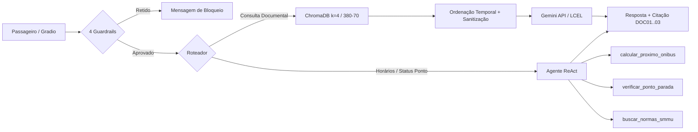

# 🚌 NovaMobi 407 — Assistente de Mobilidade Urbana (Frente A)

| Item | Detalhes |
|---|---|
| **Disciplina** | Prompt and Artificial Intelligence — FIAP (2026.2) |
| **Turma** | `1CCPJ` (Modalidade: Dupla) |
| **Integrantes** | Gustavo de Souza Correa (`RM570746`) e Arthur Tae Gun Yong (`RM570647`) |
| **Frente** | A — Mobilidade Urbana (Linha 407 — Prefeitura de Nova Esperança) |
| **Vídeo Demo** | Ver link em `https://youtu.be/ala2IAh9wmU` |

## Fluxo do Sistema

## Base Documental e Armadilhas (`2_base_documental/`)

| ID | Arquivo | Publicação | Resumo e Papel nos Testes |
|---|---|---|---|
| `DOC01` | `DOC01_itinerario_linha_407.md` | 10/03/2026 | Itinerário Vila Aurora ⇄ Centro, tarifa R$ 4,80, gratuidade 65+ anos, Ponto P-18 ativo e saídas às 10h00/14h00. |
| `DOC02` | `DOC02_portaria_alteracao_407.md` | 02/10/2026 | Portaria SMMU 118/2026: suspende o P-18 (usar P-18A a 350m), corta saídas de 10h00 e 14h00 em dias úteis, soma +12 min na viagem e cria micro-ônibus de apoio (60+, gestantes e mobilidade reduzida). |
| `DOC03` | `DOC03_comunicado_terminal_central.md` | 20/10/2026 | Obras no Terminal Central até 15/12/2026, embarque na Plataforma B, banheiros no Mercado Municipal e **detalhe escondido**: 2ª via do Passe Livre apenas na Central do Cidadão (Rua das Flores, 200) via 156. |

## Decisões Técnicas e Métricas

- **Chunking selecionado:** Configuração **E2 (`chunk_size=380`, `chunk_overlap=70`)** → 19 chunks (comparada com **E1 `900/0`** → 7 chunks). Isolou o parágrafo final do `DOC03` sobre a Central do Cidadão.
- **Agente ReAct (3 Tools):** `calcular_proximo_onibus`, `verificar_ponto_parada` e `buscar_normas_smmu`, evitando contas de cabeça e tratando códigos inexistentes (`P-99`).
- **4 Guardrails ativos:** Fora de escopo, Anti-Prompt Injection (entrada + sanitização no `DOC03`), LGPD (bloqueio de CPF/nomes do 156) e Limite de Confiança (`"Não sei"`).
- **Resultados RAGAS (8 questões — 4 Nível 1 + 4 Nível 2):**
  - `faithfulness`: **1.0000**
  - `answer_relevancy`: **0.9975**
  - `context_precision`: **0.9800**
  - `context_recall`: **1.0000**

## Como Executar no Google Colab

1. Abra `1_Notebook_GS2026_2.ipynb` no Google Colab.
2. Clique em **Runtime -> Run all** (`Executar tudo`).
